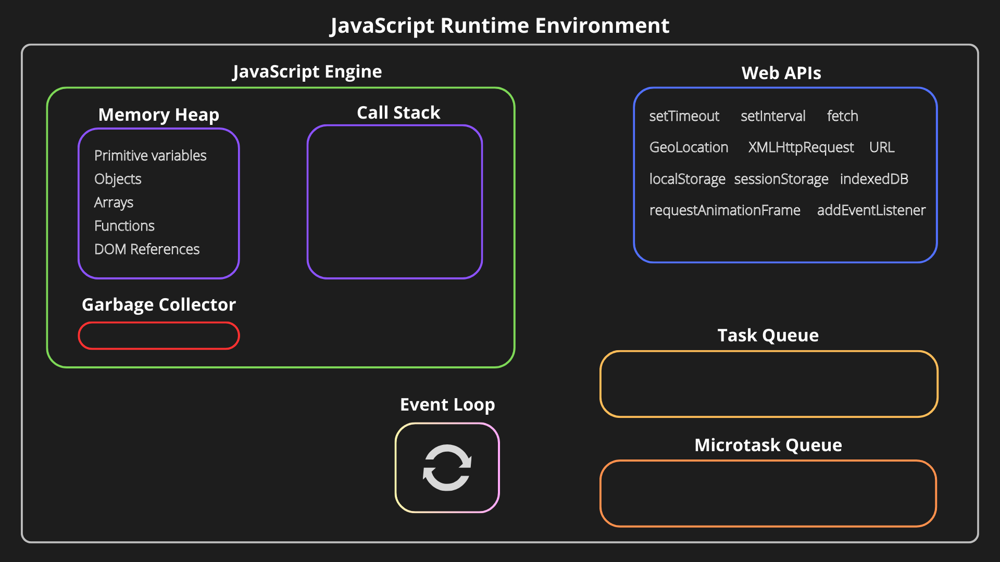

# JavaScript Runtime Environment



> This diagram is a visual overview of the JavaScript runtime, including the JavaScript engine, Web APIs, queues, and event loop.

## 1. What is the JavaScript runtime environment?

The **JavaScript runtime environment** is everything that allows JavaScript code to execute in a particular environment, such as a web browser or Node.js.

It includes the JavaScript engine and other facilities that help JavaScript interact with its environment and handle asynchronous work.

For example:
- In a browser, JavaScript can use `fetch`, timers, the DOM, and browser storage APIs.
- In Node.js, JavaScript can use filesystem, networking, timers, and other Node.js APIs.

**Important:** The diagram mainly represents a browser runtime. Node.js has a related event-loop model, but it uses Node.js APIs and libraries rather than browser Web APIs like the DOM and `localStorage`.

## 2. JavaScript engine

The **JavaScript engine** executes JavaScript code. In a browser, an example is Google's V8 engine, which is also used by Node.js.

The engine includes concepts such as:

### Memory heap

The heap is an area of memory used for data such as objects and functions.

```js
const user = { name: "Rajiv" };
const numbers = [10, 20, 30];

function greet() {
    return "Hello";
}
```

These values are managed in memory while the program needs them. The exact allocation details are implementation-dependent.

### Call stack

The **call stack** tracks the currently executing functions. JavaScript runs synchronous code on the current execution thread.

```js
function first() {
    second();
}

function second() {
    console.log("Hello");
}

first();
```

Simplified call-stack order:

1. `first()` is called.
2. `second()` is called from `first()`.
3. `console.log()` executes.
4. `second()` finishes and is removed from the stack.
5. `first()` finishes and is removed from the stack.

The stack follows **last in, first out (LIFO)** order.

### Garbage collector

The garbage collector automatically reclaims memory used by objects that are no longer reachable.

```js
let user = { name: "Rajiv" };

user = null;
// The object may become eligible for garbage collection
// if nothing else references it.
```

Setting a variable to `null` does not immediately delete the object from memory. Garbage collection timing is controlled by the engine.

## 3. Web APIs

**Web APIs** are capabilities supplied by the browser, rather than core JavaScript language features.

Examples include:

- `setTimeout()` and `setInterval()` — schedule timer callbacks.
- `fetch()` — make network requests.
- `addEventListener()` — register event handlers.
- `localStorage` and `sessionStorage` — store browser data.
- `requestAnimationFrame()` — schedule work for a browser rendering frame.
- DOM APIs — read and update the page.

Example:

```js
console.log("Start");

setTimeout(() => {
    console.log("Timer callback");
}, 0);

console.log("End");
```

Output:

```text
Start
End
Timer callback
```

Even with a delay of `0`, the timer callback does not run in the middle of the current synchronous code. It runs later when the runtime is able to process it.

## 4. Task queue (macrotask queue)

The task queue holds callbacks that are ready to run after their associated work is completed and the runtime can process them.

Common examples include:
- Timer callbacks, such as `setTimeout`.
- Many browser event callbacks, such as user interaction events.
- Some browser I/O-related callbacks.

Exact scheduling rules depend on the source of the task. A zero-millisecond timer means the callback becomes eligible after a minimum delay; it does not guarantee immediate execution.

## 5. Microtask queue

The microtask queue is used for work that should run after the current JavaScript stack finishes, before the runtime proceeds to the next task in the usual browser event-loop model.

Common sources include:
- Promise `.then()`, `.catch()`, and `.finally()` callbacks.
- Continuations after `await`.
- `queueMicrotask()`.

Example:

```js
console.log("Start");

setTimeout(() => {
    console.log("Timeout");
}, 0);

Promise.resolve().then(() => {
    console.log("Promise");
});

console.log("End");
```

Typical browser output:

```text
Start
End
Promise
Timeout
```

Why?
1. Synchronous code runs first: `Start`, then `End`.
2. The Promise callback runs as a microtask.
3. The timer callback runs as a task when eligible.

This is a useful rule of thumb for ordinary browser examples. More complex scheduling can involve additional queues and rendering steps.

## 6. Event loop

The **event loop** coordinates when queued callbacks can run. A simplified browser model is:

1. Run the current JavaScript task until its stack is empty.
2. Process pending microtasks, including microtasks added by other microtasks, until the microtask queue is empty.
3. The browser may perform rendering work when appropriate.
4. Select and run another eligible task, then repeat.

The event loop does not mean that JavaScript runs every queued callback simultaneously. In a typical browser page, JavaScript on the main thread runs one piece of JavaScript at a time.

## 7. Putting it all together

Consider:

```js
console.log("1");

setTimeout(() => {
    console.log("2");
}, 0);

Promise.resolve().then(() => {
    console.log("3");
});

console.log("4");
```

Expected output in a typical browser:

```text
1
4
3
2
```

The reasoning:

- `1` prints immediately.
- The timer callback is scheduled.
- The Promise callback is scheduled as a microtask.
- `4` prints before synchronous execution finishes.
- The microtask prints `3`.
- The timer task later prints `2`.

## 8. Browser runtime vs. Node.js runtime

| Browser | Node.js |
|---|---|
| Provides browser Web APIs | Provides Node.js APIs |
| DOM APIs are available on web pages | No built-in browser DOM by default |
| Includes APIs such as `localStorage` | Includes APIs such as `fs` and `process` |
| Uses a browser event loop | Uses the Node.js event loop, built around libuv |
| Supports Promises and microtasks | Supports Promises and microtasks |

Both environments execute JavaScript using an engine and support asynchronous programming, but their available APIs and some scheduling details differ.

## 9. Common interview questions

### Is `setTimeout` part of JavaScript itself?

The timer API is provided by the host environment. Browsers provide `setTimeout`, and Node.js provides its own timer API.

### Does `setTimeout(callback, 0)` execute immediately?

No. It schedules the callback to run later, after the current synchronous work and when the timer task becomes eligible.

### Do Promises run before timers?

In common browser examples, Promise reactions run as microtasks before the next timer task. Avoid treating this as a rule that every asynchronous operation in every environment follows the same two queues.

### What is the call stack?

It tracks active function calls and follows last-in, first-out order.

### What is garbage collection?

It is the engine's automatic process for reclaiming memory that is no longer reachable.

### Does the event loop make JavaScript multithreaded?

Not by itself. The event loop schedules work. Browsers and Node.js can use other threads or processes for certain operations, but JavaScript callbacks on a particular main thread generally execute one at a time.

## 10. Quick revision

- **Runtime environment:** the engine plus host-provided APIs and scheduling facilities.
- **Engine:** executes JavaScript.
- **Heap:** stores dynamically allocated data.
- **Call stack:** tracks active function calls.
- **Garbage collector:** reclaims unreachable memory.
- **Web APIs:** browser-provided capabilities such as timers and `fetch`.
- **Task queue:** holds eligible tasks, such as timer callbacks.
- **Microtask queue:** handles Promise reactions and related work.
- **Event loop:** coordinates execution of tasks and microtasks.

### Further reading

- [MDN: JavaScript execution model](https://developer.mozilla.org/en-US/docs/Web/JavaScript/Reference/Execution_model)
- [MDN: Event loop](https://developer.mozilla.org/en-US/docs/Web/JavaScript/Event_loop)
- [MDN: Using promises](https://developer.mozilla.org/en-US/docs/Web/JavaScript/Guide/Using_promises)
- [Node.js: The event loop](https://nodejs.org/en/learn/asynchronous-work/event-loop-timers-and-nexttick)
